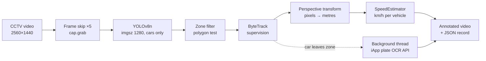

# Real-Time Vehicle Speed Detection at a Campus Crosswalk

Measures the speed of every car passing a campus crosswalk from an existing CCTV camera, flags overspeed vehicles, and reads their license plates. No radar, no extra hardware.

**▶ [Watch the demo on YouTube](https://youtu.be/qVpjDTiQrhc)**


## Results

| Metric | Result |
|---|---|
| Speed error, safe-speed test drives | **~3.18 %** average |
| Speed error, overspeed test drives | **~3.00 %** average |
| Overspeed drives flagged | **6 of 6** |
| Ground truth | 12 GPS-logged test drives |
| Throughput | 30 FPS |
| CPU cost vs. the 2025 version | **6.7× lower** |
| Measurement zone | 5.50 m × 24.30 m |

## The problem

Cars regularly pass the campus crosswalk too fast. A radar speed camera costs about 200,000 THB per installation. The campus already has CCTV pointed at the road, so this project turns that existing camera into a speed sensor with software only.

## How it works



1. **Detect.** YOLOv8n finds cars at `imgsz=1280`. Only every 5th frame is decoded; the skipped frames are advanced with `cap.grab()`, which avoids decoding them.
2. **Track.** ByteTrack (from `supervision`) gives each car a stable ID while it is inside the measurement zone.
3. **Convert to metres.** A `ViewTransformer` maps the four corners of the painted zone to a 5.50 m × 24.30 m rectangle with an OpenCV perspective transform, so the bottom-centre of each bounding box becomes a real-world position.
4. **Estimate speed.** `SpeedEstimator` keeps each car's recent positions in a `deque(maxlen=150)`, measures distance over a window of at least 0.5 s, and smooths the result. Timestamps come from the frame index, so the speed does not depend on how busy the CPU is.
5. **Read the plate.** When a car leaves the zone, a `BackgroundWorker` thread saves its crop and calls the iApp license-plate OCR REST API. The main loop never waits on the network.
6. **Report.** The output video shows colour-coded boxes (green below 40 km/h, yellow 40–60, red above 60), a sidebar of recent cars with Thai plate text rendered with Pillow, and one JSON record per vehicle.

## What changed from the 2025 version

| | 2025 | 2026 (this repo) |
|---|---|---|
| Detector | YOLOv8x on every frame | YOLOv8n on every 5th frame |
| Skipped frames | decoded | `cap.grab()` only |
| Plate OCR | blocks the main loop | background thread |
| CPU cost | baseline | **6.7× lower** |

## How to run

```bash
git clone https://github.com/Ryanajaa/Comvision_Speed_Detection.git
cd Comvision_Speed_Detection
pip install -r requirements.txt
```

1. **Models.** Put two weight files in `models/` (they are not stored in this repo):
   - `yolov8n.pt` from the [Ultralytics release assets](https://github.com/ultralytics/assets/releases/download/v8.3.0/yolov8n.pt)
   - `license_plate_detector.pt`, a YOLOv8 license-plate detector, used only to show the plate crop in the sidebar
2. **API key (optional).** Copy `.env.example` to `.env` and set `IAPP_API_KEY` from [iApp](https://iapp.co.th). Without a key the program still measures speed and skips OCR.
3. **Video.** Put a clip in `videos/` and run:

```bash
python main.py --video videos/your_clip.mp4
```

Add `--no-display` to run without the preview window. Results are written to `output/<video name>/`.

To use a different camera, change `source_polygon` (the four pixel corners of the zone) and `target_width_m` / `target_height_m` in the `CONFIG` block of `main.py`.

## Project structure

```
Comvision_Speed_Detection/
├── main.py              # full pipeline: detect, track, transform, speed, OCR, UI
├── fonts/               # TH Sarabun Bold, for Thai plate text
├── models/              # put .pt weights here (git-ignored)
├── videos/              # put input videos here (git-ignored)
├── output/              # generated video, car crops, JSON (git-ignored)
├── .env.example         # template for the OCR API key
└── requirements.txt
```

## Privacy

The CCTV footage, car crops and JSON records contain real license plates, so none of them are in this repository. `output/` and `videos/` are git-ignored.

## Limitations

- Calibrated for one camera and one painted zone. A new camera needs four new corner points and the zone's real size.
- Validated on 12 controlled daytime drives. Night, rain and heavy traffic have not been measured.
- Detects cars only (COCO class 2). Motorcycles, buses and trucks are ignored.
- Speed is an average over the 24.3 m zone, not an instantaneous reading.
- Plate OCR depends on a paid third-party API and an internet connection.

## Author

**Jitpanu Arunotai**, Robotics & AI Engineering, King Mongkut's Institute of Technology Ladkrabang (KMITL)

TH Sarabun is a Thai government font released for free use and distribution.
